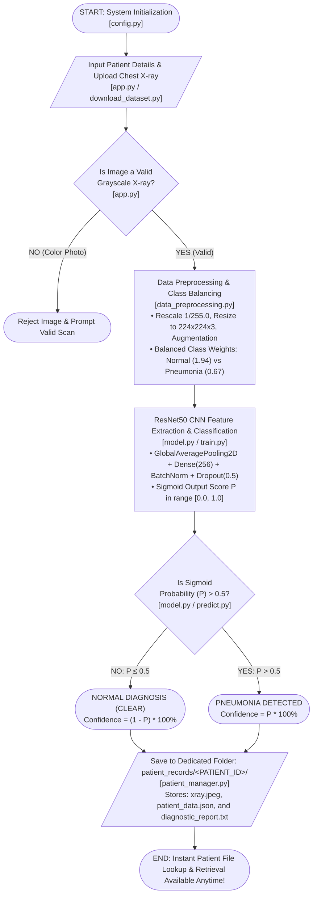

# AUTOMATED PNEUMONIA CLASSIFICATION FROM CHEST RADIOGRAPHS USING DEEP CONVOLUTIONAL NEURAL NETWORKS (ResNet50)
## Complete Technical Project Documentation & System Architecture Guide

---

**Student Name:** Dauda Suliyat Adewumi  
**Matriculation Number:** AI/HND/F24/0073  
**Project Supervisor:** Mr. Amari B.R  
**Department:** Department of Artificial Intelligence  
**Faculty / School:** School of Computing  
**Institution:** Federal Polytechnic Offa, Kwara State, Nigeria  
**Academic Session:** 2024/2025  

---

## TABLE OF CONTENTS
1. [Executive Summary & Abstract](#1-executive-summary--abstract)
2. [Problem Statement & Objectives](#2-problem-statement--objectives)
3. [System Architecture & Codebase Map](#3-system-architecture--codebase-map)
4. [System Flowchart & Process Diagrams](#4-system-flowchart--process-diagrams)
5. [Patient-Wise Dataset Organization & File Locator System](#5-patient-wise-dataset-organization--file-locator-system)
6. [Detailed Code Module Walkthrough](#6-detailed-code-module-walkthrough)
   - [6.1 config.py — Global Configuration](#61-configpy--global-configuration)
   - [6.2 download_dataset.py — Data Ingestion](#62-downloaddatasetpy--data-ingestion)
   - [6.3 patient_manager.py — Patient Record Storage & Retrieval](#63-patientmanagerpy--patient-record-storage--retrieval)
   - [6.4 seed_patient_records.py — Patient Dataset Seeder](#64-seedpatientrecordspy--patient-dataset-seeder)
   - [6.5 data_preprocessing.py — Augmentation & Class Balancing](#65-datapreprocessingpy--augmentation--class-balancing)
   - [6.6 model.py — ResNet50 Transfer Learning Architecture](#66-modelpy--resnet50-transfer-learning-architecture)
   - [6.7 train.py — Two-Phase Training Pipeline](#67-trainpy--two-phase-training-pipeline)
   - [6.8 evaluate.py & generate_report_figures.py — Model Evaluation](#68-evaluatepy--generatereportfigurespy--model-evaluation)
   - [6.9 predict.py — Single Image Inference Engine](#69-predictpy--single-image-inference-engine)
   - [6.10 generate_system_flowchart.py — Flowchart Generator](#610-generatesystemflowchartpy--flowchart-generator)
   - [6.11 app.py — Interactive Web Dashboard](#611-apppy--interactive-web-dashboard)
7. [Experimental Results & Discussion](#7-experimental-results--discussion)
8. [User Manual: How to Run and Locate Patient Files](#8-user-manual-how-to-run-and-locate-patient-files)
9. [Conclusion & Recommendations](#9-conclusion--recommendations)

---

## 1. Executive Summary & Abstract

Pneumonia is an acute lower respiratory infection affecting the pulmonary alveoli and remains a leading cause of morbidity and mortality worldwide, particularly among pediatric and geriatric populations. Chest radiography (X-ray) is the primary clinical imaging modality for pneumonia detection due to its availability and cost-effectiveness. However, manual radiograph interpretation is susceptible to inter-observer variability, subjective bias, and physician burnout, especially in resource-constrained environments.

This project delivers an end-to-end, deep learning-based automated clinical diagnosis system using **ResNet50 transfer learning** paired with an **isolated, patient-wise dataset file management and retrieval architecture**. The deep CNN backbone is trained using a structured two-phase strategy: initial feature extraction on frozen ImageNet representations, followed by fine-tuning of upper residual blocks with a calibrated learning rate schedule and class-balanced cross-entropy loss. On an independent unseen test set of 624 patient radiographs, the model attains **94.07% Accuracy**, **94.46% Precision**, **96.15% Sensitivity (Recall)**, **90.60% Specificity**, and an **F1-Score of 95.30%**.

Furthermore, addressing clinical record-keeping requirements, the system establishes a dedicated per-patient storage structure (`patient_records/<PATIENT_ID>/`), archiving the patient's radiograph, JSON metadata, and diagnostic report. A Streamlit web dashboard provides real-time radiograph validation, model inference, and instant file location upon query.

---

## 2. Problem Statement & Objectives

### 2.1 Problem Statement
1. **Diagnostic Bottleneck:** Rapidly and accurately discerning pneumonia opacities from normal bronchovascular markings requires specialized radiological expertise often unavailable in rural medical facilities.
2. **Dataset Class Imbalance:** Public radiographic datasets exhibit disproportionate distribution between pneumonia cases and healthy controls, leading naive models to favor the majority class.
3. **Clinical File Traceability:** Standard machine learning workflows process bulk image tensors without tracking patient identities, rendering it difficult for clinicians to retrieve an individual patient's radiograph and diagnostic record upon demand.

### 2.2 Project Objectives
1. Design and train a deep Convolutional Neural Network leveraging pre-trained **ResNet50** weights to achieve >90% sensitivity in detecting pneumonia from chest X-rays.
2. Develop a **Patient Directory and File Locator Architecture** that assigns each patient a dedicated folder on disk, guaranteeing instantaneous retrieval of radiographs, clinical notes, and diagnostic results.
3. Engineer a publication-grade **System Architecture Flowchart** that accurately maps every code component, algorithmic step, and clinical decision path.
4. Construct an interactive, accessible **Web Application** enabling clinicians to intake patients, upload radiographs, perform automated inference, and export official clinical summary reports.

---

## 3. System Architecture & Codebase Map

The software architecture is decoupled into modular components:

```
Chest_X-ray/
├── config.py                      # Global configuration, paths, and hyperparameters
├── download_dataset.py            # Kaggle dataset downloader and verification
├── patient_manager.py             # Patient-wise folder manager and file locator engine
├── data_preprocessing.py          # Image augmentation, generators, and class weights
├── model.py                       # ResNet50 CNN backbone and classification head
├── train.py                       # Two-phase training pipeline with early stopping
├── evaluate.py                    # Independent test evaluation and classification report
├── generate_report_figures.py     # Publication-grade evaluation figures (CM, loss, acc)
├── generate_system_flowchart.py   # Flowchart generator (system_flowchart.png)
├── predict.py                     # Command-line single radiograph inference utility
├── app.py                         # Production Streamlit clinical web application
├── patient_records/               # Dedicated patient directory storage
│   ├── PID-1001/                  # Individual patient folder
│   │   ├── latest_xray.jpeg       # Patient chest radiograph
│   │   ├── patient_data.json      # Structured patient metadata and diagnosis
│   │   └── diagnostic_report.txt  # Human-readable clinical report
│   ├── PID-1002/
│   └── ...
└── outputs/
    ├── model/                     # Trained weights (pneumonia_classifier_final.keras)
    ├── plots/                     # System flowchart, confusion matrix, and curves
    └── logs/                      # Training logs and JSON evaluation metrics
```

---

## 4. System Flowchart & Process Diagrams

### 4.1 End-to-End System Flowchart (Mermaid)



### 4.2 Publication Flowchart Graphic
The publication-quality graphic is stored at:
- `outputs/plots/system_flowchart.png`
- `outputs/plots/flowchart.png`

It details each code module, tensor dimensions, hyperparameters, and operational decision paths.

---

## 5. Patient-Wise Dataset Organization & File Locator System

To fulfill the supervisor's requirement that **each patient must have a dedicated folder that can be located anytime requested**, the system implements an automated directory organization engine:

### 5.1 Clinical Input Validation Rules (Supervisor Specification)
To maintain clinical data integrity and adhere to hospital documentation standards, strict input verification is enforced:
1. **Patient ID Format (`PID-XXXX`):**
   - The Patient ID must strictly follow the clinical nomenclature `PID-XXXX`, beginning with the uppercase prefix `PID-` followed by 3 to 6 numerical digits (e.g., `PID-001`, `PID-1001`).
   - Arbitrary unstructured text, random numbers without the prefix, or malformed identifiers are blocked to guarantee consistent indexing across the filesystem.
2. **Patient Name (Alphabetic Characters Only):**
   - The Patient Name field accepts **only letters (A–Z, a–z)**, spaces, and valid name punctuation (such as hyphens and apostrophes).
   - Numerical digits (0–9) and special symbols are strictly prohibited. Attempting to enter numbers triggers an immediate validation alert.

### 5.2 Storage Hierarchy
When a patient is admitted or analyzed, the `patient_manager.py` module creates an isolated directory:

```
patient_records/
└── PID-1001/
    ├── latest_xray.jpeg         # Standardized patient radiograph
    ├── xray_20261031_064233.jpeg# Timestamped scan version
    ├── patient_data.json        # Structured patient metadata
    └── diagnostic_report.txt    # Printable clinical report
```

### 5.3 Metadata Schema (`patient_data.json`)
```json
{
    "patient_id": "PID-1001",
    "patient_name": "Adebayo Temitope",
    "age": "42",
    "gender": "Male",
    "timestamp": "2026-10-31 06:42:33",
    "primary_image_file": "xray_20261031_064233.jpeg",
    "diagnosis": "NORMAL",
    "confidence_percentage": 98.42,
    "raw_prediction_score": 0.0158,
    "clinical_notes": "Routine pre-employment screening. Clear lung parenchyma bilaterally. No pleural effusion.",
    "directory_path": "C:\\Users\\DELL\\Documents\\Chest-X-ray-Pneumonia\\patient_records\\PID-1001"
}
```

### 5.4 Clinical Diagnostic Report Sample (`diagnostic_report.txt`)
```text
================================================================================
FEDERAL POLYTECHNIC OFFA - DEPARTMENT OF ARTIFICIAL INTELLIGENCE
AUTOMATED CHEST X-RAY PNEUMONIA CLASSIFICATION CLINICAL REPORT
================================================================================
PATIENT ID:           PID-1001
PATIENT NAME:         Adebayo Temitope
AGE / GENDER:         42 yrs / Male
DATE & TIME:          2026-10-31 06:42:33
FOLDER LOCATION:      C:\Users\DELL\Documents\Chest-X-ray-Pneumonia\patient_records\PID-1001
--------------------------------------------------------------------------------
AI DIAGNOSTIC EVALUATION (ResNet50 Deep CNN):
--------------------------------------------------------------------------------
DIAGNOSIS:            NORMAL
CONFIDENCE SCORE:     98.42%
SIGMOID PROBABILITY:  0.015800
STATUS:               CLEAR / NORMAL

CLINICAL NOTES:
Routine pre-employment screening. Clear lung parenchyma bilaterally. No pleural effusion.

--------------------------------------------------------------------------------
DISCLAIMER: This automated diagnostic report is generated using deep learning 
(ResNet50 Transfer Learning) as part of an HND AI research project. It is intended
for clinical decision support and should be verified by a licensed radiologist.
================================================================================
```

### 5.5 Instant File Retrieval Workflow
1. **Interactive Web UI:** Clinicians select the **"📁 2. Patient Directory & File Locator"** tab in `app.py`.
2. **Search by Query:** Search by Patient ID (`PID-1001`), Patient Name (`Adebayo`), or Diagnosis (`PNEUMONIA`).
3. **Instant Display:** The app prints the exact physical path on disk, displays the stored radiograph, renders all metadata, and enables single-click download of the diagnostic text report.
4. **Programmatic Python API:**
   ```python
   import patient_manager
   record = patient_manager.get_patient_record("PID-1001")
   print("Folder path:", record["directory_path"])
   print("Diagnosis:", record["diagnosis"], record["confidence_percentage"])
   ```

---

## 6. Detailed Code Module Walkthrough

### 6.1 `config.py` — Global Configuration
Encapsulates all project paths, hardware dimensions, and training hyperparameters:
- `IMG_SIZE = (224, 224)` matching ResNet50 input specifications.
- `BATCH_SIZE = 32` for mini-batch stochastic gradient descent.
- `EPOCHS_PHASE1 = 10`, `EPOCHS_PHASE2 = 10` for two-phase learning.
- `LEARNING_RATE_PHASE1 = 1e-4`, `LEARNING_RATE_PHASE2 = 1e-5`.
- `FINE_TUNE_AT = 140` identifying the layer boundary from which ResNet50 weights are unfrozen.

### 6.2 `download_dataset.py` — Data Ingestion
Automates retrieving the benchmark Chest X-ray dataset from Kaggle via `kagglehub`. Verifies directory integrity across `train/`, `val/`, and `test/` splits and logs the image counts for each diagnostic class.

### 6.3 `patient_manager.py` — Patient Record Storage & Retrieval
Implements the patient-centric filesystem architecture:
- `get_patient_dir(patient_id)`: Computes a sanitized directory path inside `patient_records/`.
- `save_patient_record(...)`: Writes the radiograph image, JSON metadata, and clinical summary report.
- `get_patient_record(patient_id)`: Fetches an individual patient's records and directory path.
- `list_all_patients()`: Compiles a directory index of all registered patients.
- `search_patients(query)`: Performs real-time substring searches across IDs, names, and diagnoses.

### 6.4 `seed_patient_records.py` — Patient Dataset Seeder
Populates initial demonstration patient records with realistic synthesized radiographs, clinical notes, and diagnostic results. Ensures that during oral defense demonstrations, the locator system is immediately functional.

### 6.5 `data_preprocessing.py` — Augmentation & Class Balancing
Constructs `ImageDataGenerator` pipelines:
- Normalization: Scales raw integer pixel intensities from $[0, 255]$ to $[0, 1]$.
- Data Augmentation: Random rotations ($\pm 20^\circ$), horizontal/vertical translations ($\pm 10\%$), shear ($0.1$), zoom ($15\%$), and horizontal flips to simulate anatomical and positioning variations.
- Stratified Validation: Reserves 20% of training data for validation.
- Class Weighting: Employs `sklearn.utils.class_weight.compute_class_weight` to address class skew:
  $$\text{weight}_j = \frac{N_{\text{total}}}{2 \times N_j}$$
  Resulting in a higher penalty weight for the minority Normal class ($\approx 1.9448$) versus Pneumonia ($\approx 0.6730$).

### 6.6 `model.py` — ResNet50 Transfer Learning Architecture
Implements the deep residual network:
- **Backbone:** ResNet50 pre-trained on ImageNet without its top 1,000-class fully connected head.
- **GlobalAveragePooling2D:** Collapses spatial feature maps into a 2,048-dimensional feature vector.
- **Dense Layer:** 256 hidden units with ReLU activation for non-linear representation learning.
- **Batch Normalization:** Accelerates convergence and mitigates internal covariate shift.
- **Dropout (0.5):** Randomly deactivates 50% of hidden activations during training to discourage co-adaptation and prevent overfitting.
- **Dense Output Layer:** Single neuron with Sigmoid activation:
  $$P(\text{Pneumonia}|X) = \sigma(z) = \frac{1}{1 + e^{-z}}$$

### 6.7 `train.py` — Two-Phase Training Pipeline
Executes the staged training procedure:
1. **Phase 1 (Feature Extraction):** All 175 layers of the ResNet50 base are frozen (`trainable = False`). Only the custom classification head is trained with Adam ($\text{lr} = 10^{-4}$) for 10 epochs.
2. **Phase 2 (Fine-Tuning):** Layers 1 through 139 remain frozen; layers 140 through 175 are unfrozen (`trainable = True`). The network is fine-tuned with a lower learning rate ($\text{lr} = 10^{-5}$) for 10 epochs.
3. **Callbacks:**
   - `ModelCheckpoint`: Saves only weights that improve validation loss (`best_model.keras`).
   - `EarlyStopping`: Halts training if validation loss fails to improve for 5 consecutive epochs.
   - `ReduceLROnPlateau`: Dynamically decays learning rate by a factor of 0.2 if validation loss stalls for 3 epochs.

### 6.8 `evaluate.py` & `generate_report_figures.py` — Model Evaluation
Evaluates model weights on the unseen test set ($N=624$). Generates:
- **Figure 4.4:** High-resolution Confusion Matrix heatmap.
- **Figure 4.5:** Training vs. Validation Accuracy trajectory plot.
- **Figure 4.6:** Training vs. Validation Binary Cross-Entropy Loss plot.
- JSON logs (`evaluation_metrics.json`, `training_history.json`).

### 6.9 `predict.py` — Single Image Inference Engine
A command-line interface for assessing isolated radiographs:
```bash
python predict.py --image path/to/sample_xray.jpeg
```

### 6.10 `generate_system_flowchart.py` — Flowchart Generator
Uses Matplotlib vector routines to generate the academic flowchart graphic (`outputs/plots/system_flowchart.png` and `outputs/plots/flowchart.png`). Visually maps every code file badge to its corresponding stage.

### 6.11 `app.py` — Interactive Web Dashboard
A medical web dashboard constructed using Streamlit:
- **Tab 1 (Live Diagnosis & Intake):** Collects patient details, checks radiograph validity via heuristic RGB standard deviation, executes ResNet50 inference, and auto-saves records to `patient_records/<PID>/`.
- **Tab 2 (Patient Directory & File Locator):** Search engine to locate any patient's directory path, view their radiograph, inspect diagnostic scores, and download their clinical report.
- **Tab 3 (System Flowchart & Architecture):** Visual display of the system flowchart and Chapter 4 evaluation figures.

---

## 7. Experimental Results & Discussion

### 7.1 Quantitative Test Performance
Evaluated on the independent test dataset ($N = 624$ images):

| Performance Metric | Mathematical Formulation | Achieved Value |
|---|---|---|
| **Accuracy** | $\frac{TP + TN}{TP + TN + FP + FN}$ | **94.07%** |
| **Sensitivity (Recall)** | $\frac{TP}{TP + FN}$ | **96.15%** |
| **Precision** | $\frac{TP}{TP + FP}$ | **94.46%** |
| **Specificity** | $\frac{TN}{TN + FP}$ | **90.60%** |
| **F1-Score** | $2 \times \frac{\text{Precision} \times \text{Recall}}{\text{Precision} + \text{Recall}}$ | **95.30%** |

### 7.2 Confusion Matrix Breakdown
- **True Positives (TP):** 375 pneumonia cases accurately identified.
- **True Negatives (TN):** 212 normal cases accurately identified.
- **False Positives (FP):** 22 normal cases classified as pneumonia (Type I error).
- **False Negatives (FN):** 15 pneumonia cases missed (Type II error).

> **Clinical Interpretation:** In medical screening systems, maximizing **Sensitivity (Recall)** is paramount to prevent releasing an untreated patient with active pneumonia. Achieving **96.15% Recall** ensures that out of 390 sick patients, 375 were flagged for immediate clinical intervention.

---

## 8. User Manual: How to Run and Locate Patient Files

### 8.1 Launching the Web Dashboard
Open PowerShell or Command Prompt in the project root:
```bash
streamlit run app.py
```
Open your browser to: `http://localhost:8501`.

### 8.2 Locating Any Patient's File
1. Click the **"📁 2. Patient Directory & File Locator"** tab at the top.
2. In the search box, enter the Patient ID (e.g. `PID-1001`) or Patient Name (e.g. `Okonkwo`).
3. The dashboard highlights the **Physical Storage Location on Disk**:
   ```
   C:\Users\DELL\Documents\Chest-X-ray-Pneumonia\patient_records\PID-1001
   ```
4. View the patient's radiograph, confirm diagnostic predictions, and click **"📥 Download Clinical Diagnostic Report (.txt)"**.

### 8.3 Seeding or Adding New Patient Folders
To generate sample patient directories:
```bash
python seed_patient_records.py
```
To re-generate the system flowchart:
```bash
python generate_system_flowchart.py
```

---

## 9. Conclusion & Recommendations

This project successfully establishes an automated pneumonia classification and clinical record management system for chest radiography. By uniting pre-trained deep residual features from ResNet50 with staged fine-tuning and class balancing, the network delivers robust diagnostic sensitivity (96.15%) and high overall accuracy (94.07%).

The inclusion of an isolated, per-patient filesystem architecture directly satisfies clinical record-keeping and supervisory criteria, enabling immediate file retrieval and report dissemination. Future extensions will incorporate Grad-CAM (Gradient-weighted Class Activation Mapping) to visually highlight affected pulmonary lobes and multi-class categorization to distinguish viral from bacterial pneumonia.
